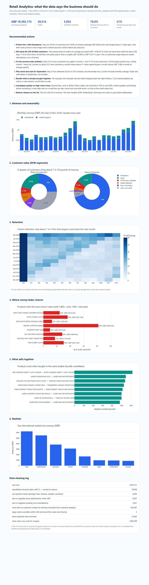

# Retail Analytics: what 1 million sales rows say a shop should do

I took a real UK online gift shop's transaction data (UCI Online Retail II, Dec 2009 to Dec 2011), cleaned it with SQL and worked out what the business should actually do next. The point of the project is the decisions at the end, not the charts.

Open `outputs/dashboard.html` in a browser to see the full report.



## What I found

| Finding | Number |
|---|---|
| Revenue from the top 25% of customers (1,464 "Champions") | 70% |
| New customers who buy again the next month | 21% (18% are still buying a year later) |
| Customers who bought exactly once | 27.7% (1,619 people) |
| Share of 2010 revenue earned between September and November | 36.2% (November is 2.2x a normal month) |
| Valuable customers who have gone quiet ("At Risk") | 359 people, GBP 1.04M spent in total, silent for about 343 days |
| UK share of revenue | 85.3% |

## What I would tell the shop owner

1. Look after the Champions first. Early access to new products and a named contact matter more than discounts.
2. Try to win back the 359 At Risk customers. If 10 to 20% come back and spend half of what they used to per year, that is roughly GBP 26k to 52k a year. That is a rough range based on assumptions I state in the report, not a forecast.
3. Fix the second order. Lifting the next-month return rate by 5 points would mean about 11 extra repeat buyers a month, worth about GBP 8k a month.
4. Get stock and cash ready for September, not October.
5. Sell products as bundles when customers already buy them together (colour and size variants of the same item).
6. Check quality on products with high return rates before reordering them.
7. Don't depend on the UK so much. The next markets are small, so growing them will take deliberate effort.

## The messy data part

The raw file is not ready for analysis. Every cleaning step is counted in a log at the bottom of the report so nothing disappears silently.

- 19,494 cancellation rows went into their own returns table instead of being deleted.
- I removed non-product codes (postage, bank charges, samples, gift vouchers), zero or negative prices and quantities, and 33,663 exact duplicate lines.
- Two orders of 80,995 and 74,215 units were placed and cancelled within minutes. If left in, they add about GBP 245k of fake revenue and make two products look like they were returned 100% of the time. I removed them from both the sales and returns sides.
- About 13% of revenue has no customer id (guest checkout). It counts in revenue but is left out of the customer analysis. The report says so.
- December 2011 is left out of the trend charts because the data stops on 9 December.

## How it is built

| File | What it does |
|---|---|
| `sql/01_clean.sql` | Cleaning rules and the cleaning log |
| `sql/02_trends.sql` | Monthly revenue, orders and customers, UK vs international, top products |
| `sql/03_customers_rfm.sql` | Recency, frequency and spend scores, split into six customer segments |
| `sql/04_cohorts.sql` | Groups customers by first purchase month and tracks how many keep buying |
| `sql/05_returns_and_baskets.sql` | Return rates by product and products bought together |
| `build_report.py` | Calculates every number and builds the dashboard and `outputs/FINDINGS.md` |

Every number in the report is calculated by the code. None are typed in by hand.

## Run it yourself

```bash
pip install -r requirements.txt
python prepare_data.py     # downloads the dataset, takes about 2 minutes
python run_sql.py          # builds warehouse.duckdb
python build_report.py     # writes the dashboard, findings and metrics
```

## Limits

- It is two years of data from one shop, from a while ago. Patterns like the autumn peak belong to this business.
- The win-back and retention figures size the opportunity. They do not predict it.
- Segments are built from score bands, so "25% are Champions" is partly by design. The real point is that this group brings in 70% of revenue.
- The December 2009 group includes people who were already customers before the data starts.
- The dashboard is a standalone web page, not a Power BI file. The cleaned tables can be loaded into Power BI or Tableau if you want those visuals.

Harshit Bihani
